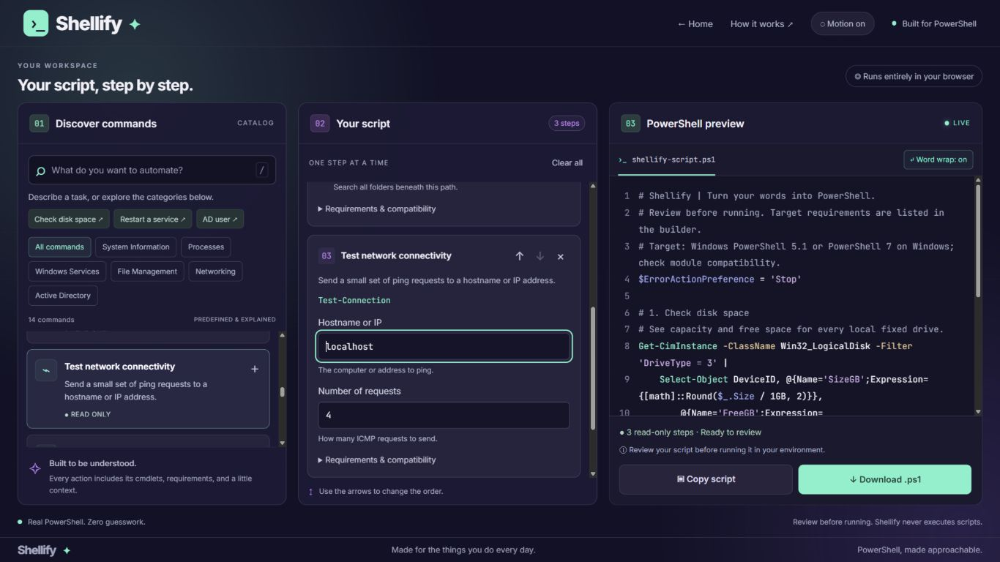
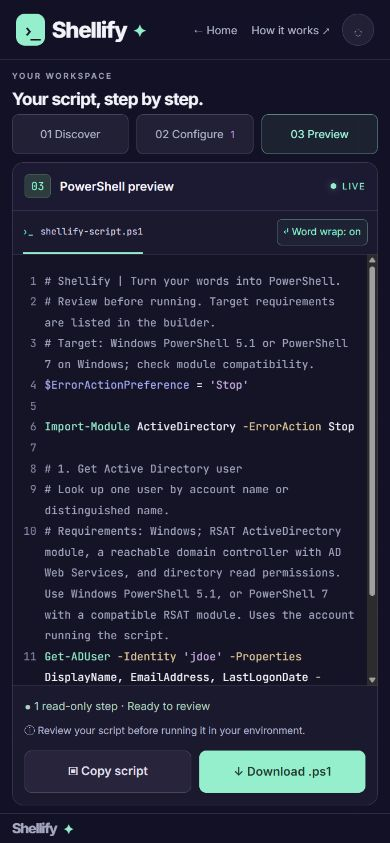

<div align="center">

# ›_ Shellify ✦

### Turn your words into PowerShell.

**Less syntax. More getting things done.**<br>
Build scripts with guided commands, editable steps, and a live PowerShell preview.

[](https://shellify.thehawk6353.workers.dev/)

**The best way to interact with Shellify is the [live demo ↗](https://shellify.thehawk6353.workers.dev/).**<br>
Open it in your browser and choose **Get started** to enter the dedicated builder—no account or installation needed.


</div>

---

## ✦ What is Shellify?

Shellify makes common PowerShell tasks easier to assemble and understand. Find a supported action using a simple description, configure its fields, and watch the script take shape beside you.

It uses **fourteen predefined templates and deterministic keyword matching**. It doesn't call an AI model, accept arbitrary code, or execute the generated script. Your work stays in the browser's memory until you copy or download it.

## 01 / Find → configure → export

1. **Find an action.** Search for a task such as `disk space`, `list files`, or `ping`, or browse a category.
2. **Make it yours.** Add commands, fill in their parameters, and use the arrows to change the step order.
3. **Review the preview.** See the actual PowerShell, requirements, and any validation errors as you build.
4. **Take it with you.** Copy the script or download `shellify-script.ps1` for review and use in your environment.

**Try this:** Keep the initial disk-space step, add **List files in a directory**, then add **Test network connectivity**. Change the folder and hostname to see the preview update.



<details>
<summary><strong>📱 Mobile preview</strong></summary>

<p align="center"></p>

</details>

Screenshots were captured from a local run of the repository.

## 02 / What's in the toolbox?

| Action | Main cmdlets | Purpose |
| :--- | :--- | :--- |
| Get computer information | `Get-ComputerInfo` | Windows, operating system, and hardware details |
| Check disk space | `Get-CimInstance` | Capacity and free space on fixed drives |
| List running processes | `Get-Process` | Processes sorted by memory usage |
| Get Windows services | `Get-Service` | Service names and current status |
| Restart a Windows service | `Get-Service`, `Restart-Service`, `Invoke-Command` | Restart an exact service name locally or remotely |
| List files in a directory | `Get-ChildItem` | Files in a selected folder, optionally including subfolders |
| Find older files | `Get-ChildItem`, `Where-Object` | Files older than a configured last-modified cutoff |
| Get Active Directory user | `Get-ADUser` | Look up a user by exact identity |
| List Active Directory computers | `Get-ADComputer` | Bounded domain computer inventory |
| List Active Directory groups | `Get-ADGroup` | Bounded group inventory |
| Get Active Directory group members | `Get-ADGroupMember` | Direct or nested group membership |
| Find locked Active Directory users | `Search-ADAccount` | Report locked accounts |
| Find inactive Active Directory users | `Search-ADAccount` | Report accounts with no recent directory logon |
| Test network connectivity | `Test-Connection` | Ping a hostname or IP address |

### The useful details

- **Live preview** with syntax highlighting, line numbers, and toggleable word wrap. Wrap starts enabled; the browser remembers your preference without changing exported scripts.
- **Editable, reorderable steps** with per-action requirements.
- **Validation before export** for required fields, numeric bounds, and supported input types.
- **Read-only and system-modifying labels** so the impact of an action is visible.
- **Copy and `.ps1` download**, with UTF-8 BOM and Windows line endings on downloads.
- **Desktop workspace that fits the viewport**, with independent scrolling for long catalogs, steps, and scripts. Phones and tablets use Discover, Configure, and Preview tabs, with one comfortable pane visible at a time.
- **Subtle animated background**, a motion toggle, and support for reduced-motion preferences.
- **Responsive dark interface** with mint and purple accents, keyboard focus styling, and reduced-motion support.
- **No runtime libraries or backend**; Google Fonts are optional external assets with system fallbacks.

## 03 / Run locally

The **[live demo](https://shellify.thehawk6353.workers.dev/)** is the recommended starting point. To explore or edit the source on your own machine, install **Node.js 20 or later** and clone the repo:

```sh
git clone https://github.com/Matthew-Hawk/Shellify.git
cd Shellify
npm start
```

Open **[http://127.0.0.1:4173](http://127.0.0.1:4173)** and select **Get started**, or open `http://127.0.0.1:4173/builder.html` directly. Leave the terminal running while you use the app; press **Ctrl+C** to stop it.

There are no package dependencies to install. If you prefer downloading a ZIP from GitHub, extract it, open a terminal in the folder containing `package.json`, and run `npm start`.

Use a local server instead of opening `dist/index.html` directly: the app loads JavaScript modules, and clipboard access needs localhost or HTTPS plus browser permission.

### Checks

```sh
npm test
npm run build
```

`npm test` covers generation, quoting, validation, ordering, and command matching. The native PowerShell parser test runs only on Windows with both Windows PowerShell and PowerShell 7 installed; it parses scripts without executing them.

`npm run build` checks the static entry files in `dist/`. It does not compile or bundle the app.

## 04 / Know the boundaries

**Shellify builds scripts; it never runs them.** The output targets Windows PowerShell 5.1 and PowerShell 7 on Windows. Review the full script and each action's requirements before running it on a target machine.

- Search matches supported phrases; it isn't a general-purpose natural-language interpreter. Unsupported requests produce no commands, and numbers typed into search do not fill parameter fields.
- Restarting a service is the only current system-modifying action. Confirmation is enabled by default. Remote restarts need configured PowerShell remoting and suitable permissions; interactive confirmation can behave differently remotely.
- File actions list results; they do not delete files.
- Validation and literal quoting help control generated syntax, but the browser cannot verify target-machine permissions, policies, connectivity, or installed modules.
- Word wrap is a display preference stored locally when browser storage is available. Copied and downloaded scripts retain their original line breaks.
- Refreshing the page resets your script to the initial disk-space step. Copy or download work you want to keep.

Active Directory actions require the RSAT ActiveDirectory module, a reachable domain controller with AD Web Services, and directory read permissions. Generated scripts import the module once. Use Windows PowerShell 5.1 or PowerShell 7 with a compatible module. Optional server and search-base fields scope queries; inventories and account reports have result limits. Inactivity uses replicated logon information and may lag; review accounts before making changes. These templates have been syntax-tested, but have not been executed against a live domain.

[Active Directory module reference](https://learn.microsoft.com/en-us/powershell/module/activedirectory/).

## 05 / Under the hood

| File / folder | Responsibility |
| :--- | :--- |
| `dist/index.html` | Landing page with the Get started entry point |
| `dist/builder.html` | Dedicated responsive script builder and guide |
| `dist/js/appearance.js` | Shared background motion and reduced-motion support |
| `dist/js/landing.js` | Compatibility redirects for old builder bookmarks |
| `dist/styles.css` | Dark theme, responsive layouts, and typography |
| `dist/js/commands.js` | Action catalog, parameter schemas, requirements, and templates |
| `dist/js/matcher.js` | Conservative keyword and alias matching |
| `dist/js/validation.js` | Parameter validation and PowerShell literal quoting |
| `dist/js/generator.js` | Ordered script composition and validation gate |
| `dist/js/app.js` | Catalog, step editor, preview, clipboard, and downloads |
| `tools/` | Local server and static readiness check |
| `test/` | Engine tests and Windows parser test |
| `docs/screenshots/` | Images used in this README |

**Add a command:** Define its metadata, parameter schema, generator, requirements, and search phrases in `commands.js`, then add coverage in `test/`. If it needs new modules or platforms, update the script-level compatibility comments too.

**Host a copy:** Publish the contents of `dist/` to a static host. The app requires no backend or server-side PowerShell runtime. Serve it over HTTPS for clipboard support.

---

<div align="center">

**✦ A little less memorizing. A lot more automating.**

[Try Shellify ↗](https://shellify.thehawk6353.workers.dev/) · [Matthew Hawkins](https://github.com/Matthew-Hawk)

</div>
