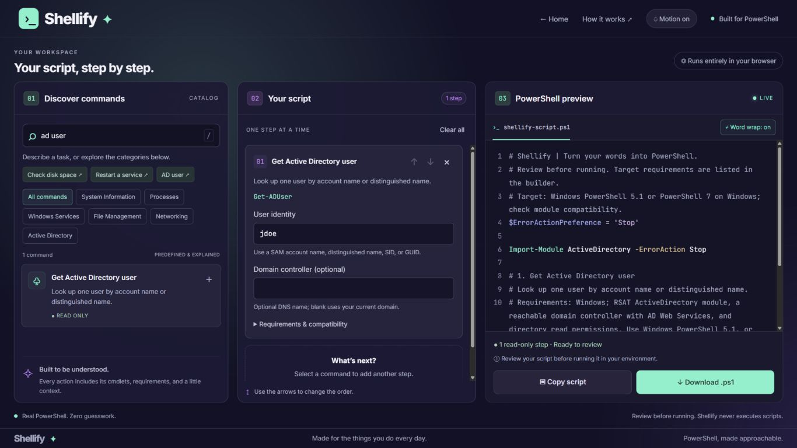

<div align="center">

# ›_ Shellify ✦

### Turn your words into PowerShell.

**Less syntax. More getting things done.**<br>
Build scripts with guided commands, editable steps, and a live PowerShell preview.

[](https://shellify.thehawk6353.workers.dev/)

<!-- Demo GIF placeholder: replace the static preview below with docs/screenshots/demo.gif when recorded. -->


*Demo GIF coming soon — static preview shown above.*

</div>

## Why Shellify?

- **Start with a task.** Find curated commands using plain-language descriptions, cmdlet names, or flags.
- **See what you are building.** Guided fields and a live PowerShell preview make each step visible.
- **Build repeatable workflows.** Reuse shared inputs, combine steps, and save scripts on this browser.
- **Take your work with you.** Copy or download PowerShell, or export an editable project.
- **Stay in control.** No account or AI service required; Shellify builds scripts and never runs them.

## Quick start

Open the **[live demo](https://shellify.thehawk6353.workers.dev/)** and select **Start building**. No installation needed.

To run locally, install **Node.js 20 or later**, then:

```sh
git clone https://github.com/Matthew-Hawk/Shellify.git
cd Shellify
npm start
```

Open [http://127.0.0.1:4173](http://127.0.0.1:4173) and select **Start building**, or go directly to [the builder](http://127.0.0.1:4173/builder.html). No package installation is required to run the app. Keep the server running; press **Ctrl+C** to stop it.

## Features

Explore the [full command catalog](docs/commands.md), including the Sysadmin Essentials collection, or start with a workflow. Configure flags, shared inputs, bulk targets, and result exports; review requirements in the live preview; then choose Commented or Compact code output. Autosaved drafts, favorites, Undo, a saved script library, and portable projects help you continue later. Desktop and mobile layouts support the same workflow.

Generated scripts target Windows PowerShell 5.1 and PowerShell 7 on Windows. Review each action's requirements before running the output in your environment.

## Documentation

See **[docs/](docs/README.md)** for [detailed features](docs/features.md), the [generated command table](docs/commands.md), and [development, checks, and hosting](docs/development.md).
